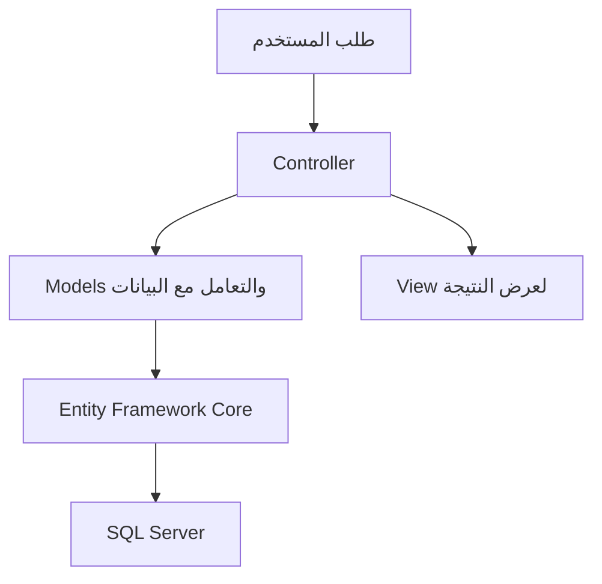

# سِدرة | Sidrah

متجر إلكتروني نفذته ضمن برنامج تطوير تطبيقات الويب باستخدام ASP.NET Core MVC بأكاديمية طويق.

طبقت فيه بناء تطبيق ويب وربطه بقاعدة بيانات، وتنظيم الكود وفق نمط MVC لفصل الواجهات عن معالجة الطلبات ونماذج البيانات.

## ما طبقته

- تنظيم التطبيق إلى Models وViews وControllers.
- تنفيذ عمليات الإضافة والعرض والتعديل والحذف.
- التعامل مع البيانات باستخدام Entity Framework Core.
- ربط التطبيق بقاعدة بيانات SQL Server.
- إدارة تغييرات قاعدة البيانات باستخدام Migrations.
- تنظيم موارد الواجهات لدعم اللغات
## بنية التطبيق

## التقنيات

C# · ASP.NET Core MVC · Entity Framework Core · SQL Server · HTML · CSS · JavaScript

## إعداد التشغيل

يتطلب المشروع .NET SDK المتوافق مع ملف المشروع وSQL Server.

يُضبط اتصال قاعدة البيانات محليًا، ثم تُستعاد الحزم وتُطبق ترحيلات Entity Framework Core قبل تشغيل التطبيق.

إعداد الاتصال الموجود في المستودع مثال محلي. تُحفظ بيانات الاتصال الخاصة باستخدام User Secrets أو متغيرات البيئة.

---

تنفيذ: ريم بريكان الشمري  
برنامج تطوير تطبيقات الويب — أكاديمية طويق
